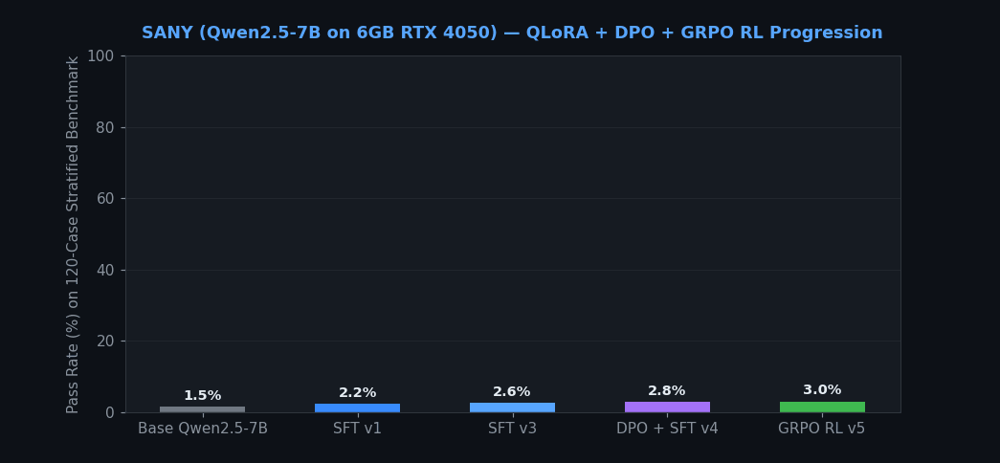
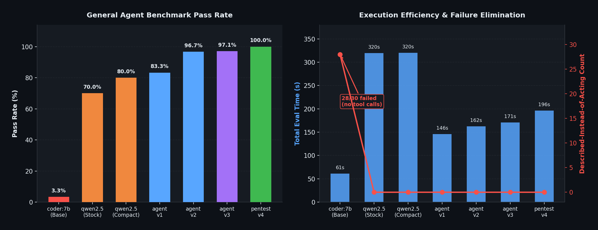
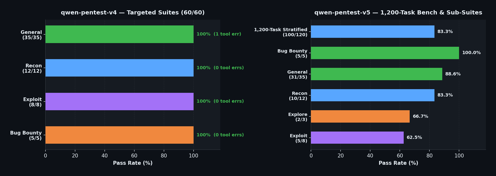
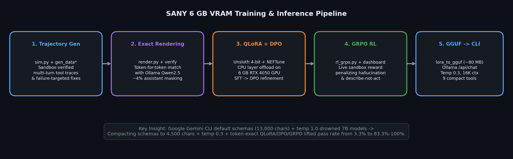

# SANY — Local Agentic CLI & Fine-Tuned Qwen2.5-7B Systems/Pentest Model


-3fb950?style=for-the-badge)
-a371f7?style=for-the-badge)


**SANY** is a fully local, autonomous tool-calling terminal agent powered by a custom fine-tuned **Qwen2.5-7B-Instruct** model running via **Ollama**, paired with a patched TypeScript/Node **Gemini CLI** runtime (`cli/`). Every component—from synthetic trajectory generation and token-exact template verification to 4-bit QLoRA, DPO, and sandbox-verified GRPO reinforcement learning—was engineered to run and train on a **6 GB RTX 4050 Laptop GPU** with zero cloud APIs.

<p align="center">
  
</p>

---

## Why Fine-Tuning & Prompt Engineering Were Both Necessary

Out of the box, stock 7B models fail catastrophically as multi-step CLI agents:
1. **`qwen2.5-coder:7b` passed only 1 / 30 (3.3%)** on our general tool-calling benchmark—failing **28 out of 30 tasks** by *describing* shell commands in markdown instead of actually invoking tools.
2. **Schema Bloat:** Google's default Gemini CLI tool descriptions are **~13,000 characters** long, drowning a 7B model's attention budget. Compacting all 9 tool schemas (`localToolSchemas.ts`) down to **~4,500 characters** and rewriting `local/system.md` (~2,200 chars) immediately lifted stock `qwen2.5:7b` from **70.0% (21/30)** to **80.0% (24/30)**.
3. **Temperature & Template Pitfalls:** Gemini CLI's default temperature (`1.0`) made 7B outputs erratic, and Ollama's Qwen chat template silently drops tool calls if assistant text accompanies a tool call. Fixing `localContentGenerator.ts` to use **temperature `0.3`**, `16,384` context, and empty-text tool-call turns eliminated silent tool drops.

---

## Benchmark Progression & Suite Results

### 1. Base vs. Fine-Tuned Progression (Pass Rate, Speed & Failure Elimination)
<p align="center">
  
</p>

| Model Checkpoint | Pass Rate | Eval Time | Tool Errors | Described-Instead-of-Acting |
| :--- | :---: | :---: | :---: | :---: |
| `qwen2.5-coder:7b` (Base) | 1 / 30 (**3.3%**) | 61.2 s | 0 | **28** |
| `qwen2.5:7b` (Stock Prompt) | 21 / 30 (**70.0%**) | 319.6 s | 1 | 0 |
| `qwen2.5:7b` (Compact Schemas) | 24 / 30 (**80.0%**) | 320.1 s | 2 | 0 |
| `qwen-agent-v1` (QLoRA SFT) | 25 / 30 (**83.3%**) | 145.8 s | 1 | 0 |
| `qwen-agent-v2` (Failure-Targeted) | 29 / 30 (**96.7%**) | 162.3 s | 3 | 0 |
| `qwen-agent-v3` (Expanded Sim) | 33 / 34 (**97.1%**) | 170.9 s | 2 | 0 |
| `qwen-pentest-v4` (General Suite) | 35 / 35 (**100.0%**) | 196.1 s | 1 | **0** |

Fine-tuning didn't just push accuracy from **70% → 100%**—it cut total benchmark runtime nearly in half (**320.1 s → 145.8–196.1 s**) because the model stopped wasting turns on redundant or malformed tool calls.

### 2. Targeted Security Suites & 1,200-Task Stratified Benchmark
<p align="center">
  
</p>

* **`qwen-pentest-v4`:** Scored **60 / 60 (100%)** across all 4 targeted suites — General (`35/35`), Recon (`12/12`), Exploit (`8/8`), and Bug Bounty (`5/5`) — with **0 tool errors** across Recon, Exploit, and Bug Bounty.
* **`qwen-pentest-v5` (120-Case Stratified Sample of 1,200-Task Benchmark, `run_1000_bench.py --stratified 5`):** Scored **100 / 120 (83.33%)** overall with **0 described-instead-of-acting failures** (Bug Bounty `5/5`, General `31/35`, Recon `10/12`, Explore `2/3`, Exploit `5/8`).

> **Evaluation Methodology & Data Split:** The 4 targeted suites (`60/60`) serve as regression & capability checks covering the specific failure modes targeted during training. The **1,200-task benchmark** (`eval_cases_1000.py`, sampled via `--stratified 5` for 120 cases) tests procedurally parameterized unseen task instances (randomized ports, filenames, IPs, and payloads) to measure generalization.  
> **Repository Note:** SANY is published as a consolidated monorepo combining `cli/` and `finetune/` from separate local development histories.

---

## How Everything Was Built (`finetune/` + `cli/`)

<p align="center">
  
</p>

### Part 1: Training, Alignment & Evaluation (`finetune/`)
1. **Deterministic Simulator & Synthetic Trajectory Generation (`sim.py`, `gen_data*.py`):**
   - Rather than training on static single-turn Q&A, `sim.py` and `sandbox_env.py` simulate multi-step shell, filesystem, networking (`ip neigh`, `ss`, `nmap`), and web-exploitation (`curl`, `gobuster`, SQLi, JWT, DOM XSS) environments.
   - Every failure uncovered in evaluation (e.g., forgetting to write `report.md`/`writeup.md`, confusing a LAN switch with the `.1` gateway, or scanning out-of-scope IPs not in `scope.txt`) feeds directly into targeted synthetic trajectories (`run_v5_polish.sh`).
2. **Token-Exact Ollama Chat Template Verification (`render.py`, `verify_render.py`):**
   - `render.py` formats every conversation into Qwen2.5's exact `<|im_start|>`/`<|im_end|>` structure and `verify_render.py` checks it **token-for-token** against Ollama's live rendering.
   - **Assistant-Only Loss Masking (~4% of tokens):** The system prompt, user messages, and tool outputs are masked out of the cross-entropy loss so gradients only update on assistant tool calls and final answers.
3. **6 GB VRAM QLoRA + DPO + Sandbox-Verified GRPO (`train.py`, `dpo_refine.py`, `rl_grpo.py`):**
   - **SFT (`train.py`):** Uses Unsloth 4-bit quantization (`unsloth/Qwen2.5-7B-Instruct-bnb-4bit`) with `offload_layers='auto'` and NEFTune noise injection to fit on a **6 GB RTX 4050**, producing a ~80 MB GGUF LoRA adapter (`lora_to_gguf.py`).
   - **DPO (`dpo_refine.py`):** Refines preference pairs (direct tool action vs. verbose refusal/hallucination).
   - **GRPO RL (`rl_grpo.py`, `rl_dashboard.py`):** Runs live rollouts against `sandbox_env.py` with verifiable outcome rewards and a web monitoring dashboard.
4. **Cognitive Memory Layer (`sany_memory.py`):**
   - Adds episodic experience replay (reflexion), session fact pinning, and `<thought>` scratchpad parsing for multi-turn consistency.

### Part 2: Patched Local Agent Runtime (`cli/`)
* **`packages/core/src/core/localContentGenerator.ts`:** Translates Gemini CLI's internal conversation state to Ollama's `/api/chat` endpoint (`LOCAL_LLM_BASE_URL`, default `http://localhost:11434`) with `temperature: 0.3` and `num_ctx: 16384`.
* **`packages/core/src/core/localToolSchemas.ts`:** Compact 4,500-character tool definitions for the 9 core local & web tools, kept 100% synchronized with `finetune/` training data.
* **`packages/core/src/tools/localWebSearch.ts` & `web-fetch.ts`:** Offline/cloud-free web search via SearXNG (`SEARXNG_URL`) or Bing scraping, plus direct HTML-to-text fetching capped at 12,000 characters.
* **`local/gemini-local`:** One-command launcher (`sany` / `qagent`) overriding model, context length, and system prompt without touching cloud auth.

---

## Quick Start

### 1. Build & Run the CLI
```bash
cd cli
npm install
npm run bundle
./local/gemini-local
```
Environment overrides: `LOCAL_LLM_MODEL` (default `qwen-pentest-v5`), `LOCAL_LLM_BASE_URL` (default `http://localhost:11434`), `LOCAL_LLM_NUM_CTX` (default `16384`).

### 2. Fine-Tuning, RL & Benchmarking
```bash
cd finetune
python3 -m venv .venv && source .venv/bin/activate

# Verify token-exact template rendering against Ollama:
python verify_render.py

# Generate data, train QLoRA adapter, convert to GGUF, and register in Ollama:
./run_v5_polish.sh

# Run 1,200-task stratified benchmark evaluation:
python run_1000_bench.py --model qwen-pentest-v5 --stratified 5
```
See [`finetune/GUIDE.md`](finetune/GUIDE.md) for a deep dive into the training pipeline, loss masking, and simulator design.
